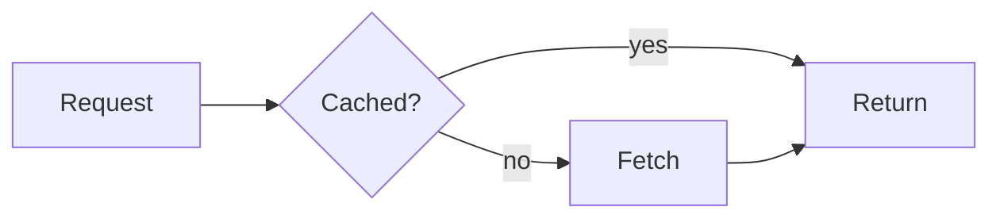
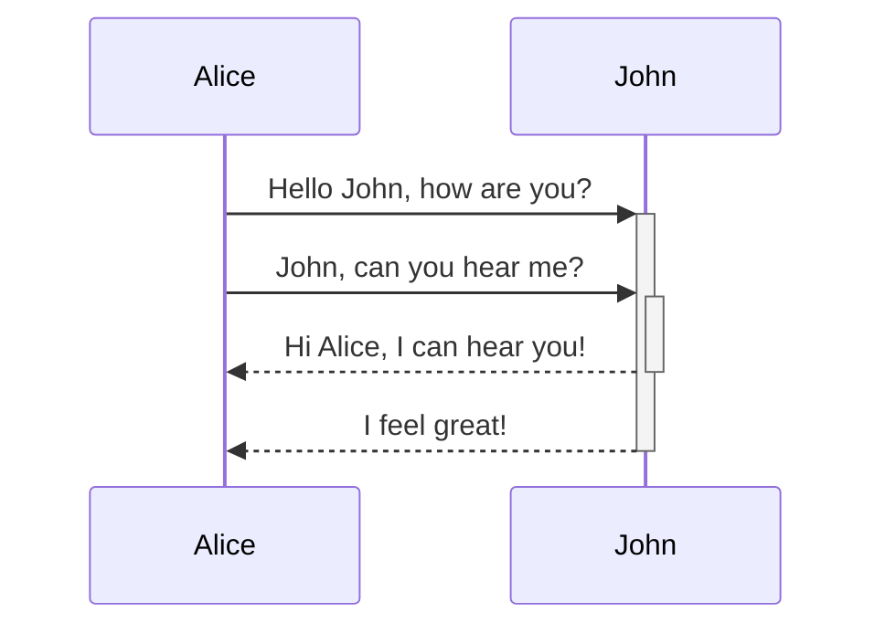
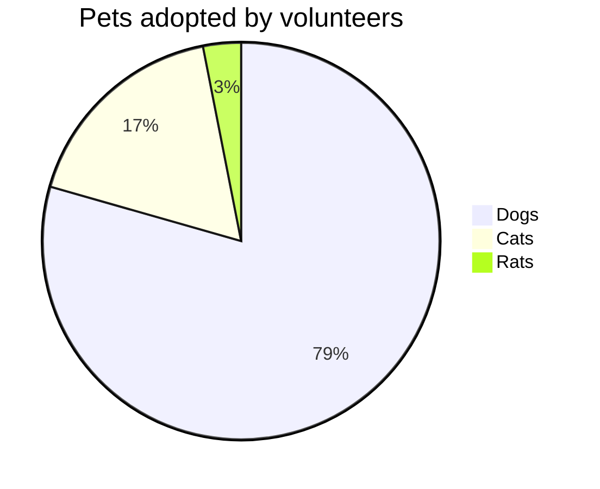

# Tabs

<adev-tab-group label="Package manager">
<adev-tab label="npm">

```sh
npm install @angular/core
```

</adev-tab>
<adev-tab label="pnpm">

```sh
pnpm add @angular/core
```

</adev-tab>
<adev-tab label="Some text">

Tabs hold any slide content. Use the arrow keys, Home and End on the tab bar.

</adev-tab>
</adev-tab-group>

---
layout: default
---

# Tabs, one per click

<adev-tab-group clicks label="Steps">
<adev-tab label="Define">

Describe the state with a `signal()`.

</adev-tab>
<adev-tab label="Derive">

Compute values with `computed()`.

</adev-tab>
<adev-tab label="React">

Run side effects with `effect()`.

</adev-tab>
</adev-tab-group>

---
layout: default
---

# Images


---
layout: default
---

# Image with a caption

<adev-image src="/adev-media-sample.png" alt="A sample picture" caption="A gradient with a hairline border and rounded corners" size="medium" />

---
layout: default
---

# Video

<adev-video src="https://www.youtube.com/embed/O47uUnJjbJc" title="Expression changed after checked" />

---
layout: default
---

# Flowchart



---
layout: default
---

# Sequence diagram



---
layout: default
---

# Pie chart


