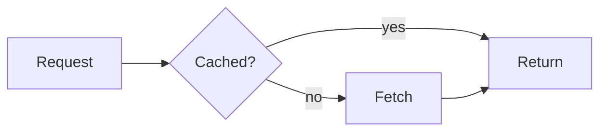
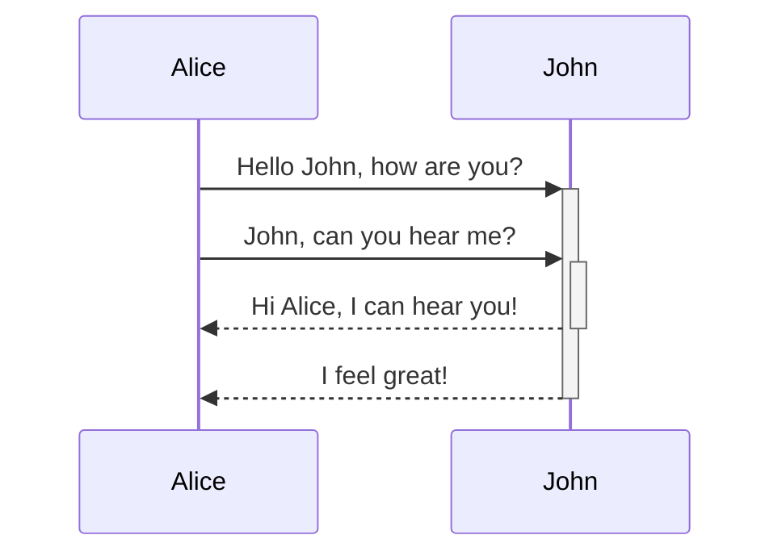
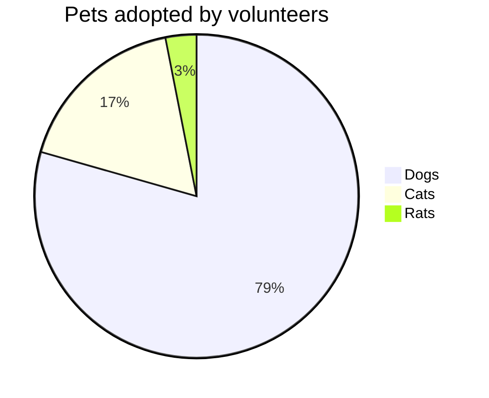

# adev

The look of angular.dev, for slides

---
layout: intro
---

# Signals, from the start

Reactive state in Angular

Ada Lovelace, ng-conf

---
layout: default
---

# The default layout

Body text in Inter, headings in Inter Tight. Links look like [angular.dev](https://angular.dev), inline code like `signal()`.

- Gradient markers on lists
- Hairline borders from the gray scale
- Four pixel corners

```ts [counter.ts]
import { signal } from '@angular/core';

export const count = signal(0);
count.update((n) => n + 1);
```

---
layout: center
---

# Centered

Content in the middle of the slide

---
layout: section
---

# A new section

What comes next

---
layout: two-cols
---

# Two columns

Left column

::right::

## Right column

- One
- Two
- Three

---
layout: image-right
---

# Image right

The picture side is drawn in CSS when no image is given.

- Pass `image: /photo.png` to show a photo

---
layout: image-left
---

# Image left

The same layout with the picture first.

- Pass `image: /photo.png` to show a photo

---
layout: quote
---

# Make it work, make it right, make it fast.

Kent Beck

---
layout: fact
---

# 100%

of the slides, in light and dark

---
layout: statement
---

# Small, safe, and useful

Slides that look like the docs

---
layout: default
---

# Alerts

<div class="grid grid-cols-4 gap-x-5">
<adev-alert kind="note">Notes use the blue rail.</adev-alert>
<adev-alert kind="tip">Tips use the green and cyan rail.</adev-alert>
<adev-alert kind="todo">A to do, in gray.</adev-alert>
<adev-alert kind="question">Questions are blue to cyan.</adev-alert>
<adev-alert kind="summary">Summaries are violet.</adev-alert>
<adev-alert kind="tldr">Too long, did not read, in pink.</adev-alert>
<adev-alert kind="warning">Warnings are amber to orange.</adev-alert>
<adev-alert kind="critical">Critical is pink to orange red.</adev-alert>
<adev-alert kind="important">Important is red to pink.</adev-alert>
<adev-alert kind="helpful" title="Handy">Helpful, with a title of your own.</adev-alert>
</div>

---
layout: default
---

# Alerts as paragraphs

NOTE: A paragraph that starts with the kind, a colon and a space becomes an alert, with **markdown** and `code` inside.

TIP: Works for all nine kinds. A paragraph ends at the blank line,
so it may take several lines.

CRITICAL: Braces are safe: `{{ value() }}` and a plain &#123;brace&#125;.

<adev-alert kind="todo" bare>The tag form also takes `bare`, which drops the label.</adev-alert>

---
layout: default
---

# Pills

<adev-pill-row>
<adev-pill title="Signals"></adev-pill>
<adev-pill title="Standalone"></adev-pill>
<adev-pill title="Zoneless"></adev-pill>
<adev-pill title="SSR"></adev-pill>
<adev-pill title="Hydration"></adev-pill>
<adev-pill title="Control flow"></adev-pill>
<adev-pill title="Defer"></adev-pill>
</adev-pill-row>

Links, internal and external:

<adev-pill-row>
<adev-pill href="/guide" title="Guide"></adev-pill>
<adev-pill href="https://angular.dev" title="angular.dev"></adev-pill>
<adev-pill href="https://github.com/angular/angular" title="Source"></adev-pill>
</adev-pill-row>

---
layout: default
---

# API item labels

<div class="flex flex-wrap items-center gap-3">
<adev-api-label kind="class"></adev-api-label>
<adev-api-label kind="const"></adev-api-label>
<adev-api-label kind="decorator"></adev-api-label>
<adev-api-label kind="directive"></adev-api-label>
<adev-api-label kind="element"></adev-api-label>
<adev-api-label kind="enum"></adev-api-label>
<adev-api-label kind="function"></adev-api-label>
<adev-api-label kind="interface"></adev-api-label>
<adev-api-label kind="pipe"></adev-api-label>
<adev-api-label kind="ng-module"></adev-api-label>
<adev-api-label kind="type-alias"></adev-api-label>
<adev-api-label kind="block"></adev-api-label>
</div>

<div class="flex flex-wrap items-center gap-3 mt-6">
<adev-api-label kind="class" full></adev-api-label>
<adev-api-label kind="function" full></adev-api-label>
<adev-api-label kind="deprecated" full version="v20"></adev-api-label>
<adev-api-label kind="developer-preview" full version="v19"></adev-api-label>
<adev-api-label kind="experimental" full></adev-api-label>
<adev-api-label kind="stable" full></adev-api-label>
</div>

---
layout: default
---

# Keyboard keys

Press <kbd>Ctrl</kbd> + <kbd>K</kbd> to search, <kbd>Esc</kbd> to close.

With the component: <adev-kbd>Shift</adev-kbd> + <adev-kbd>Enter</adev-kbd>

---
layout: default
---

# Cards

<adev-card-grid cols="3">
  <adev-card label="Step 1" title="Fork">Fork the repository and clone it.</adev-card>
  <adev-card label="Step 2" title="Fix">Make a small change with a test.</adev-card>
  <adev-card label="Step 3" title="Send" hot>Open the pull request.</adev-card>
</adev-card-grid>

<adev-card-grid cols="2">
  <adev-card title="Signals">Fine grained reactivity.</adev-card>
  <adev-card title="Zoneless">Change detection without zone.js.</adev-card>
</adev-card-grid>

---
layout: center
---

<div class="adev-stats">
<adev-stat value="15+" label="small pull requests" />
<adev-stat label="issues closed"><adev-count-up value to="240" suffix="+" /></adev-stat>
<adev-stat label="docs pages touched"><adev-count-up value to="38" /></adev-stat>
</div>

---
layout: default
---

# Code card, steps and buttons

<adev-code-card title="app.ts" label="TypeScript">

```ts
@Component({ selector: 'app-root', template: '<h1>Hello</h1>' })
export class App {}
```

</adev-code-card>

<adev-steps>

1. Install the CLI
2. Run `ng new`
3. Start the dev server

</adev-steps>

<adev-button>Get started</adev-button> <adev-button variant="secondary">Read the docs</adev-button>

<div class="flex gap-4 mt-6"><adev-button>In a flex row</adev-button><adev-button variant="secondary">With a gap</adev-button></div>

<div class="mt-6"><adev-button>On its own line</adev-button></div>
<div class="mt-4"><adev-button variant="secondary">And another</adev-button></div>

---
layout: default
---

# Tables, quotes and links

| Token | Light | Dark |
| ----- | ----- | ---- |
| Page | `white` | `gray-1000` |
| Border | `gray-200` | `gray-700` |

> Quotes get the same gradient rail as an alert.

Read [the guide](https://angular.dev/guide) or the [overview](/overview).

---
layout: default
---

# Headings

## Heading two

### Heading three

#### Heading four

##### Heading five

###### Heading six

Body text under the headings.

<hr/>

A rule above this line.

---
layout: default
---

# Decorative header

<adev-decorative-header title="What is Angular?" imgSrc="data:image/svg+xml,%3Csvg xmlns='http://www.w3.org/2000/svg' viewBox='0 0 100 60'%3E%3Cdefs%3E%3ClinearGradient id='g'%3E%3Cstop offset='0' stop-color='%23e90464'/%3E%3Cstop offset='1' stop-color='%238514f5'/%3E%3C/linearGradient%3E%3C/defs%3E%3Crect width='100' height='60' rx='30' fill='url(%23g)'/%3E%3C/svg%3E">A platform for building web applications.</adev-decorative-header>

<adev-decorative-header title="On the hero gradient" gradient>Same header with the brand panel.</adev-decorative-header>

---
layout: default
---

# Angular, built in

```angular-ts [user.component.ts]
@Component({
  selector: 'app-user',
  template: `
    @if (user(); as u) {
      <h2 [class.admin]="u.admin">{{ u.name | titlecase }}</h2>
    }
  `,
})
export class UserComponent {
  user = input<User>();
}
```

```ng-html [alias.html]
@if (ready()) { <input [(ngModel)]="draft" #field (keyup.enter)="save(field.value)" /> }
```

---
layout: default
---

# Control flow

```angular-html [list.component.html]
@for (item of items(); track item.id) {
  <li [class.done]="item.done" (click)="toggle(item)">{{ item.title }}</li>
} @empty {
  <li>Nothing yet</li>
}
@defer (on viewport) {
  <app-chart [data]="data" />
} @placeholder {
  <p>Chart</p>
}
@switch (status) {
  @case ('ok') { <app-ok /> }
  @default { <app-fail /> }
}
```

---
theme: adev
title: adev code
layout: default
---

# Prefer and avoid

```ts {prefer} [counter.ts]
const count = signal(0);
count.update((n) => n + 1);
```

```ts {avoid} [counter.ts]
let count = 0;
count = count + 1;
```

---
layout: default
---

# Prefer and avoid, as components

<adev-prefer>

Keep state in a signal and derive the rest with `computed()`.

</adev-prefer>

<adev-avoid title="legacy.ts">

```ts
this.total = this.price * this.quantity;
```

</adev-avoid>

---
layout: default
---

# Line numbers and highlights

```ts [user.ts] {2,4-5} {lines:true}
import { Component, input } from '@angular/core';
@Component({
  selector: 'app-user',
  template: `<h2>Hello</h2>`,
})
export class User {
  name = input.required<string>();
}
```

---
layout: default
---

# Diff lines

```ts [user.ts] {lines:true}
export class User {
  name = input<string>(); // [!code --]
  name = input.required<string>(); // [!code ++]
  greeting = computed(() => `Hello, ${this.name()}`);
}
```

---
layout: default
---

# Files in tabs

::code-group

```ts [app.ts]
@Component({ selector: 'app-root', templateUrl: './app.html' })
export class App {}
```

```html [app.html]
<h1>Hello</h1>
<app-user name="Ada" />
```

```css [app.css]
h1 {
  color: hotpink;
}
```

::

---
layout: default
---

# Code from a file

<<< ./snippets/user.component.ts#greeting ts

---
theme: adev
title: adev media
layout: default
---

# Tabs

<adev-tab-group label="Package manager">
<adev-tab label="npm">

```sh
npm install @angular/core
```

</adev-tab>
<adev-tab label="pnpm">

```sh
pnpm add @angular/core
```

</adev-tab>
<adev-tab label="Some text">

Tabs hold any slide content. Use the arrow keys, Home and End on the tab bar.

</adev-tab>
</adev-tab-group>

---
layout: default
---

# Tabs, one per click

<adev-tab-group clicks label="Steps">
<adev-tab label="Define">

Describe the state with a `signal()`.

</adev-tab>
<adev-tab label="Derive">

Compute values with `computed()`.

</adev-tab>
<adev-tab label="React">

Run side effects with `effect()`.

</adev-tab>
</adev-tab-group>

---
layout: default
---

# Images


---
layout: default
---

# Image with a caption

<adev-image src="/adev-media-sample.png" alt="A sample picture" caption="A gradient with a hairline border and rounded corners" size="medium" />

---
layout: default
---

# Video

<adev-video src="https://www.youtube.com/embed/O47uUnJjbJc" title="Expression changed after checked" />

---
layout: default
---

# Flowchart



---
layout: default
---

# Sequence diagram



---
layout: default
---

# Pie chart



---
layout: end
---

# Thank you

adev for slide.ng
